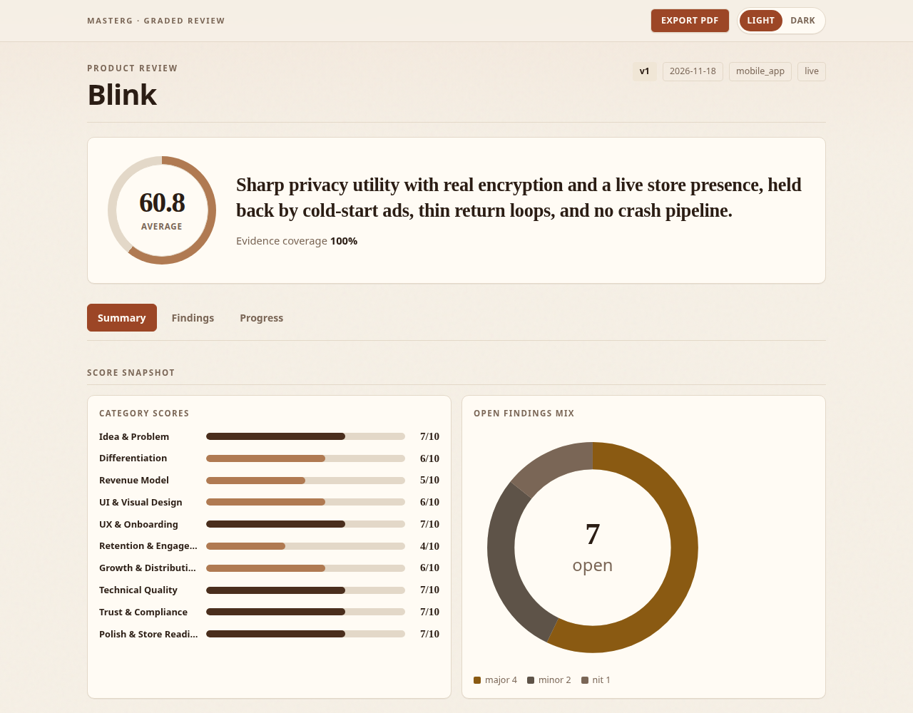
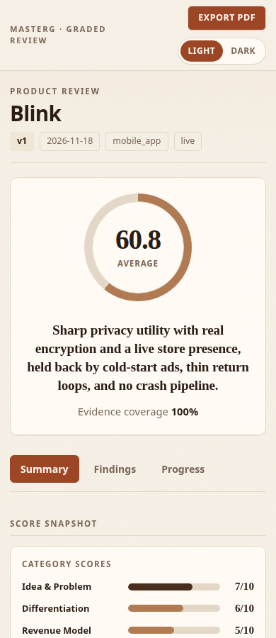
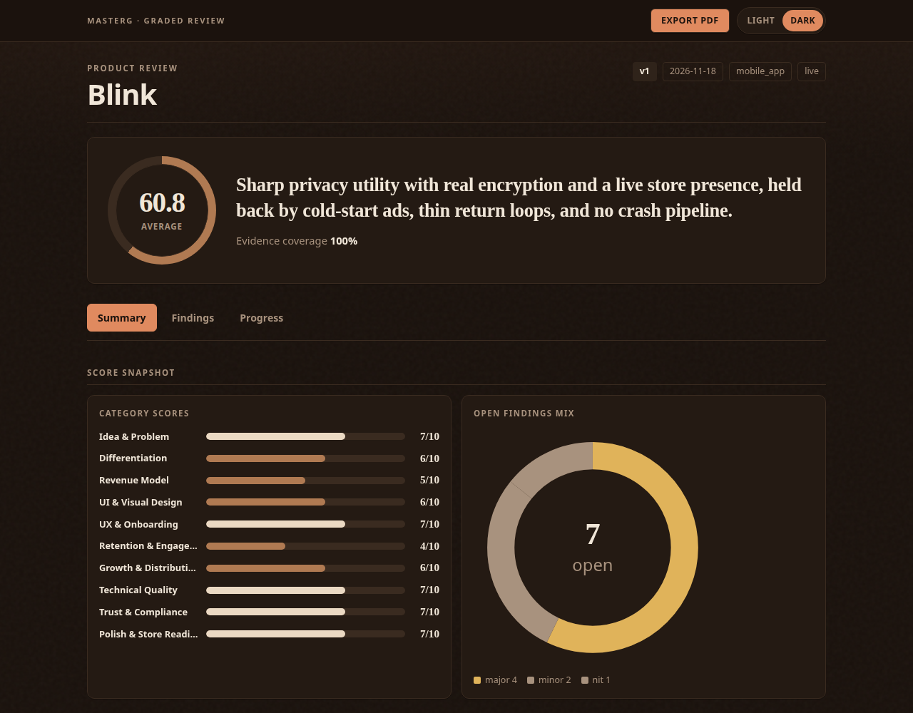

<h1 align="center">MasterG</h1>

<p align="center">
  <code>npx skills add Darkmintis/MasterG</code>
</p>

<p align="center">
  
</p>

**Strict, evidence-backed product review for apps, web apps, sites, and games.**  
You get a versioned `MasterG/` folder in *your* project: a beautiful offline report for humans, a tiny summary for agents.  
**Versions + evidence** - same rubric every run, so v1 → v2 → v3 shows what actually improved.

> Not a substitute for real user testing. Not a PR code review, security audit, or marketing-copy writer.

Keywords: AI app review, app audit, Play Console report analysis, indie app feedback, agent skill.

---

## Install

Same one-liner as above (via the [skills](https://skills.sh) CLI). Useful variants:

```bash
# Global install (all projects)
npx skills add Darkmintis/MasterG -g

# Non-interactive: skill + all detected agents
npx skills add Darkmintis/MasterG --skill masterg --all
```

Manual copy if you prefer:

```bash
cp -R skills/masterg <skills-root>/masterg
```

| Agent | Project path | User (global) path | Verified |
|---|---|---|---|
| **Cursor** | `.cursor/skills/masterg/` or `.agents/skills/masterg/` | `~/.cursor/skills/masterg/` (Cloud Agents sync this one) | [Cursor Skills docs](https://cursor.com/docs/skills) · Nov 2026 |
| **Claude Code** | `.claude/skills/masterg/` | `~/.claude/skills/masterg/` | [Claude Code skills](https://code.claude.com/docs/en/skills) · Nov 2026 |
| **Codex** | `.codex/skills/masterg/` | `~/.codex/skills/masterg/` | Compatible path listed by Cursor docs · Nov 2026 |
| **GitHub Copilot** | `.agents/skills/masterg/` | `~/.copilot/skills/masterg/` | [Agent Skills path table](https://github.com/vercel-labs/skills/blob/main/docs/agents.md) · Nov 2026 |

Only `skills/masterg/` is required. It does not depend on the rest of this repo.

**Requirement:** Python **3.9+** on the machine where `scripts/masterg.py` runs (stdlib only, no network, no pip deps). Node.js is only needed for the `npx skills` installer.

---

## Use

Ask your agent naturally, or say `/masterg`:

- "review my app" / "rate my product" / "roast my app"
- "is my app good" / "what should I fix first"
- "store readiness"
- "here's my Play Console export - how did I do vs last month?"

**Modes**

| You say | Skill does |
|---|---|
| Review / rate / roast / `/masterg` | Create the **next** version |
| "compare v1 and v3" | Run `compare`, summarize in chat |
| "show my report" | Point you to `MasterG/report.html` |

Drop store/analytics CSVs into `MasterG/inputs/vN/exports/` (gitignored) and ask again for v2+.

---

## What you get

```
MasterG/
├── report.html      ← humans: open this
├── MasterG.md       ← agents: read this (≤60 lines)
├── history.json
├── reports/v1/…     ← immutable snapshots
└── inputs/          ← raw exports (gitignored)
```

Every product gets the **same** graded-paper report layout (Light/Dark toggle, Export PDF, animated charts from your scores, custom filters, offline `file://`). Only the content changes.

Sample output (real pipeline): [`examples/sample-app/MasterG/report.html`](examples/sample-app/MasterG/report.html)

<p align="center">
  
  &nbsp;
  
</p>

---

## How scoring works

Ten fixed categories (weights sum to 100). Every score needs **evidence** or it is `unverified`.

| Category | Weight |
|---|---|
| Idea & Problem | 10 |
| Differentiation | 12 |
| Revenue Model | 12 |
| UI & Visual Design | 10 |
| UX & Onboarding | 10 |
| Retention & Engagement | 12 |
| Growth & Distribution | 10 |
| Technical Quality | 10 |
| Trust & Compliance | 6 |
| Polish & Store Readiness | 8 |

**Confidence caps:** high ≤10 · medium ≤8 · low ≤6 · unverified → no score.  
**Overall** is a weighted 0–100. If evidence coverage < 50%, no overall - the report says what inputs unlock it.

The agent writes judgments only (`draft.json`). **`scripts/masterg.py` computes** totals, deltas, ranks, HTML, and `MasterG.md`.

---

## Versioning

```
v1 ──review──▶ v2 ──review──▶ v3
     findings tracked as new / persisting / resolved / regressed
     metrics compared when period + source match
```

Old `reports/vN/` folders are **immutable**. Fixes become the next version.

---

## FAQ

**Does it change my code?**  
No. It only writes inside `MasterG/`.

**Does it send data anywhere?**  
The script is local and offline. Your agent's own model/tools apply separately.

**Why "unverified"?**  
No cited evidence for that category. Add screenshots, exports, listing text, or more code coverage.

**Can I customize the rubric?**  
Not in v1 - a fixed rubric keeps scores comparable across versions.

---

## Develop / verify

```bash
python3 skills/masterg/scripts/test_masterg.py
python3 evals/run_script_evals.py
```

Agent quality runbook (stability / no-invention / real-app): [`evals/cases/agent_runbook.md`](evals/cases/agent_runbook.md)

---

## License & links

[MIT](LICENSE) © Darkmintis

- Sample report: [examples/sample-app/MasterG/report.html](examples/sample-app/MasterG/report.html)
- Other tools: [github.com/Darkmintis](https://github.com/Darkmintis)
- Support: star this repo on GitHub if MasterG saved you a bad launch
